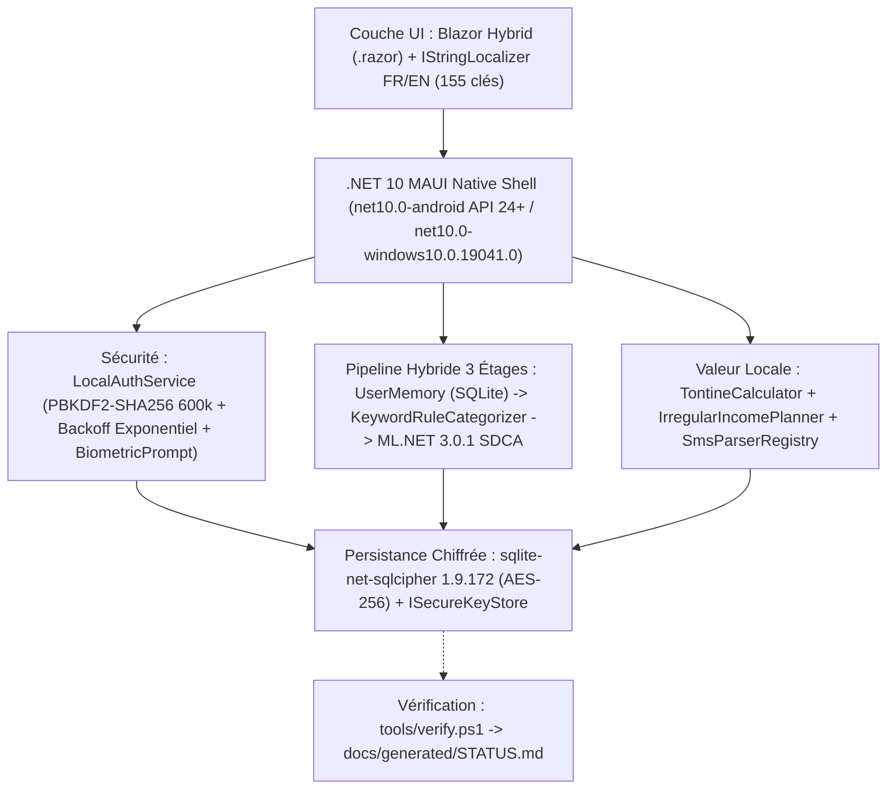

# RAPPORT DE PROJET & POST-MORTEM TECHNIQUE : SMARTBUDGET ML (v2.0.0)
**Application Mobile Local-First de Gestion Budgétaire, Tontines (Njangi) et Intelligence Artificielle Embarquée adaptée au Cameroun**

---

| **Projet** | SmartBudget ML | **Version** | v2.0.0 |
| :--- | :--- | :--- | :--- |
| **Auteur** | Lissom Eloge Dekenzo Abel | **Date** | Octobre 2026 |
| **Statut des Tests & Métriques** | Voir [`docs/generated/STATUS.md`](docs/generated/STATUS.md) (généré par `./tools/verify.ps1`) | **Dépôt GitHub** | [ElogeKenzo/SmartBudgetML](https://github.com/ElogeKenzo/SmartBudgetML.git) |
| **Architecture** | 100 % Local-First / Edge AI / Zéro permission `INTERNET` ou `READ_SMS` | **Framework** | **.NET 10.0 LTS** MAUI Blazor Hybrid (`net10.0-android`, `net10.0-windows10.0.19041.0`) |

---

## 1. Présentation Générale et Objectifs de la v2.0

### 1.1 Contexte et Refonte d'Honnêteté Technique (v1.0 → v2.0)
**SmartBudget ML** est une application mobile de finances personnelles conçue selon les principes du **Local-First Software** et de l'**Edge Computing**.  
L'audit d'ingénierie initial (`A1`–`A24`) puis l'audit approfondi de la branche `develop` en Phase 8 (`N1`–`N17`, voir [`docs/AUDIT_REGISTER.md`](docs/AUDIT_REGISTER.md)) permettent de suivre avec transparence l'état exact de chaque service et de chaque écran. Toutes les métriques quantitatives (comptes de tests, résultats des garde-fous, précision et latence du modèle ML) sont centralisées dans [`docs/generated/STATUS.md`](docs/generated/STATUS.md), généré automatiquement par `./tools/verify.ps1`.

### 1.2 Stack Technique Réelle (v2.0)

- **Framework Cible :** `.NET 10.0 LTS` (`global.json` épinglé sur `10.0.402` avec `rollForward: latestFeature`), ciblant **Android (API 24+)** et **Windows**.
- **Chiffrement au Repos :** `sqlite-net-sqlcipher 1.9.172` (chiffrement SQLite en AES-256) avec clé maître de 256 bits générée via `RandomNumberGenerator.GetBytes(32)` et stockée via `ISecureKeyStore`.
- **Authentification Locale & Biométrie :**
  - Hachage du code PIN à 6 chiffres via **PBKDF2-HMAC-SHA256 avec 600 000 itérations** (`LocalAuthService.OwaspIterations = 600_000`, `PinHashVersion = 2`), stocké dans deux colonnes distinctes `PinSalt` et `PinHash` sur `AppSettings` (avec migration transparente des anciens comptes v1 à 10 000 itérations lors de la connexion).
  - Limitation des tentatives persistante en base (`FailedPinAttempts`, `LockoutUntilUtc`, `LastFailedAttemptUtc`) avec backoff exponentiel (`30 s` au 5e échec, `1 min` au 6e, `5 min` au 7e, `15 min` à partir du 8e) et détection de recul de l'horloge système.
  - Biométrie native Android via `Android.Hardware.Biometrics.BiometricPrompt` (suppression du package bêta `Plugin.Fingerprint`).
- **Protection du Cycle de Vie & Confidentialité Android :**
  - Politique de verrouillage automatique au retour d'arrière-plan (`AutoLockPolicy` + événements `Window.Deactivated`/`Stopped`/`Resumed` dans `App.xaml.cs`).
  - Masquage de l'aperçu dans le multitâche et blocage des captures d'écran via `WindowManagerFlags.Secure` (`FLAG_SECURE`) dans `MainActivity.cs`.
  - `android:allowBackup="false"` et suppression totale des permissions `INTERNET` et `ACCESS_NETWORK_STATE` dans `AndroidManifest.xml` (seule `USE_BIOMETRIC` est déclarée).

---

## 2. Architecture Machine Learning Hybride & Prévisions

### 2.1 Pipeline de Catégorisation à 3 Étages (`ExpenseCategorizerService`)
La catégorisation combine trois étages déterministes :
1. **Étage 1 — Mémoire Utilisateur (`PredictionSource.UserMemory`) :** Recherche exacte normalisée dans les corrections enregistrées par l'utilisateur dans la table SQLite persistante `CategoryFeedback`.
2. **Étage 2 — Règles Mots-Clés Camerounais (`PredictionSource.Rules` via `KeywordRuleCategorizer`) :** Dictionnaire déterministe d'expressions locales (*bendskin, moto, clando, taxi, agence Finex/Touristique/General, ENEO, Camwater, bouteille de gaz, MTN, Orange, Camtel, Yoomee, tontine, njangi, cotisation, dîme, offrande, scolarité, pension, marché Mokolo/Mboppi/Ndokoti, soya, poisson braisé, ndolé, eru...*).
3. **Étage 3 — Modèle ML.NET SDCA (`PredictionSource.Model`) :** Classifieur multi-classes `SdcaMaximumEntropy` (`NumberOfThreads = 1`, `seed = 42`) entraîné sur `Resources/Raw/seed_fr.csv` et persisté sur disque via `IModelStore` (`FileModelStore`).
   - `Predict()` est 100 % non-bloquant (aucun appel synchrone `GetAwaiter().GetResult()`).
   - Le réentraînement incrémental est regroupé par lots (`RetrainBatchThreshold = 15` corrections) ou déclenché manuellement depuis l'écran *Paramètres*.

### 2.2 Métriques Réelles sur Jeu de Test Disjoint (`holdout_fr.csv`)
Pour éviter toute divergence documentaire, les chiffres d'évaluation (Micro-Accuracy, Macro-Accuracy, Macro-F1 pour les règles seules, ML seul et le pipeline hybride, ainsi que la latence d'inférence moyenne/p95 et la taille du modèle) ne sont pas recopiés à la main ici : ils sont générés directement par les tests dans `artifacts/ml-eval.json` et publiés dans [`docs/generated/STATUS.md`](docs/generated/STATUS.md) ainsi que détaillés dans [`docs/ML_EVALUATION.md`](docs/ML_EVALUATION.md).

### 2.3 Prévisions Budgétaires & Revenus Irréguliers (`BudgetForecastingService` & `IrregularIncomePlanner`)
- **Séparation des charges fixes (`IsFixedOrRecurring`) :** Le loyer, l'écolage ou les cotisations fixes sont comptabilisés à leur montant calendaire sans être extrapolés linéairement chaque jour du mois.
- **Indicateur de fiabilité (`ForecastReliability` dans `BudgetForecastingService.EvaluateReliability`) :**
  - En mode mensuel / enveloppe : `Low` (`DaysElapsed < 7`), `Medium` (`7` à `13` jours écoulés), `High` (`>= 14` jours écoulés).
  - En mode hebdomadaire : `Low` (`DaysElapsed < 3`), `High` (`>= 3` jours écoulés).
- **Modes budgétaires (`BudgetPeriodMode`) :** Mensuel (`Monthly`), Hebdomadaire (`Weekly`) et Enveloppe (`Envelope`).
- **Lissage des revenus irréguliers (`IrregularIncomePlanner`) :** Moyenne glissante sur 3 à 6 mois, amortissement sur réserve lors d'un mois à revenu nul (sans division par zéro), découpage en enveloppes hebdomadaires après déduction du minimum vital, et suivi du ratio de solidarité familiale (`family_solidarity`).

---

## 3. Tableau de Statut des Fonctionnalités

Chaque composant est étiqueté selon son niveau réel de vérification :
- `VÉRIFIÉ-TESTS` : Validé par la suite de tests automatisés xUnit sur l'hôte `.NET 10`.
- `VÉRIFIÉ-BUILD` : Compile en configuration `Release` (`net10.0-android` et `net10.0-windows10.0.19041.0`) via `./tools/verify.ps1`.
- `PARTIEL` : Service testé, mais intégration UI ou cycle complet en cours de finalisation en Phase 8 (voir [`docs/AUDIT_REGISTER.md`](docs/AUDIT_REGISTER.md)).
- `NON-VÉRIFIÉ-APPAREIL` : Nécessite l'exécution sur émulateur CI (Lot 8B) et sur téléphone physique via [`docs/DEVICE_TEST_CHECKLIST.md`](docs/DEVICE_TEST_CHECKLIST.md).

| Fonctionnalité / Composant | Statut de Vérification | Preuve Technique |
|---|---|---|
| Chiffrement SQLCipher 256 bits & migration auto depuis SQLite clair (`A1`) | `VÉRIFIÉ-TESTS` | `Phase3SecurityTests.EncryptedDatabase_*`, `UnencryptedDatabase_AutomaticallyMigratesToEncrypted_*` |
| Stockage de la clé via `SecureStorage` (`MauiSecureKeyStore`, `N6`) | `VÉRIFIÉ-TESTS` / `NON-VÉRIFIÉ-APPAREIL` | Clé protégée par le Keystore Android lorsque l'appareil le permet ; repli en clair `.sb_vault_key` supprimé en Lot 8C, état du coffre (`Ready`, `KeyUnavailable`, `KeyLost`) et écran `/vault-error`. |
| Évaluation réelle du modèle ML (`ModelEvaluator`, `A2`) | `VÉRIFIÉ-TESTS` | `Phase1HonestyTests.ModelEvaluator_*`, `Phase4MlHybridTests.HoldoutEvaluation_*` |
| Persistance du seuil de confiance ML (`A3`) & du feedback (`A7`) | `VÉRIFIÉ-TESTS` | `Phase1HonestyTests.AppSettingsProvider_*`, `ExpenseCategorizerService_PersistsFeedbackInSqlite_*` |
| Export CSV RFC 4180 UTF-8 BOM (`A4`) & Backup/Restore `VACUUM INTO` (`A5`, `N4`, `N5`) | `PARTIEL` | Services validés par `Phase1HonestyTests`, mais écriture dans `AppDataDirectory` sans partage système ni UI de restauration (Lot 8D). |
| PIN 6 chiffres, PBKDF2 600k itérations, anti-bruteforce & anti-rollback (`A9`) | `VÉRIFIÉ-TESTS` | `Phase3SecurityTests.PinRateLimiting_*`, `ValidatePinComplexity_*`, `PinHashMigration_*` |
| Verrouillage automatique au retour d'arrière-plan (`AutoLockPolicy`, `A8`, `N3`) | `PARTIEL` | Service `EvaluateAutoLockOnResumeAsync` testé, mais redirection UI vers `/unlock` à brancher en Lot 8C. |
| Masquage d'écran `FLAG_SECURE` (`MainActivity.cs`) & Biométrie native `BiometricPrompt` (`A15`, `N16`) | `NON-VÉRIFIÉ-APPAREIL` | Implémenté dans `MainActivity.cs` et `BiometricService.cs` (garde API 28 à corriger en Lot 8C). |
| Localisation FR/EN (155 clés dans `AppStrings`), devise XAF (`FCFA`) & 17 catégories (`A12`, `N10`) | `PARTIEL` | `Phase5CameroonLocalizationTests.*` (quelques chaînes anglaises résiduelles dans les pages à finaliser en Lot 8H). |
| Tontines / Njangi (`TontineCalculator`) & Revenus irréguliers (`IrregularIncomePlanner`, `A19`, `N1`, `N14`) | `PARTIEL` | Services testés dans `Phase6LocalValueTests.*`, mais persistance UI et branchement complet prévus en Lot 8E. |
| Parseurs SMS Orange Money CM & MTN MoMo CM sans `READ_SMS` (`SmsParserRegistry`, `N2`) | `PARTIEL` | `OrangeMoneyCameroonParser` & `MtnMomoCameroonParser` testés dans `Phase6LocalValueTests`, mais enregistrement en base et `ACTION_SEND` prévus en Lot 8F. |
| Pipeline CI/CD GitHub Actions & Test Émulateur (`A16`, `N9`) | `NON-VÉRIFIÉ-APPAREIL` | Workflow `.github/workflows/maui-android-ci.yml` à corriger et exécuter réellement en Lot 8B. |

---

## 4. Suite de Tests xUnit (`SmartBudgetML.Tests`)

Le décompte exact des tests exécutés, réussis, échoués et ignorés est généré automatiquement à chaque exécution de `./tools/verify.ps1` dans [`docs/generated/STATUS.md`](docs/generated/STATUS.md).  
La suite couvre 11 fichiers de tests :
- [`SqliteRepositoryTests.cs`](SmartBudgetML.Tests/Database/SqliteRepositoryTests.cs) : CRUD SQLite, seeding des 17 catégories camerounaises et devise XAF/fr.
- [`LocalAuthServiceTests.cs`](SmartBudgetML.Tests/Auth/LocalAuthServiceTests.cs) : Hachage PBKDF2, onboarding, vérification PIN à temps constant, biométrie.
- [`BudgetForecastingServiceTests.cs`](SmartBudgetML.Tests/ML/BudgetForecastingServiceTests.cs) : Régression linéaire OLS, statuts `OnTrack`/`Warning`/`Exceeded`.
- [`ExpenseCategorizerServiceTests.cs`](SmartBudgetML.Tests/ML/ExpenseCategorizerServiceTests.cs) : Classification NLP, Softmax, apprentissage incrémental.
- [`UiFormatTests.cs`](SmartBudgetML.Tests/UI/UiFormatTests.cs) : Sécurité culturelle SVG, formatage devises, initiales, icônes.
- [`Phase1HonestyTests.cs`](SmartBudgetML.Tests/Honesty/Phase1HonestyTests.cs) : Évaluateur ML réel, seuil persisté, export CSV RFC 4180, backup `VACUUM INTO`, formatage XAF.
- [`Phase3SecurityTests.cs`](SmartBudgetML.Tests/Security/Phase3SecurityTests.cs) : SQLCipher 256 bits, migration clair→chiffré, rate-limiting PIN, anti-rollback, `AutoLockPolicy`, purge.
- [`Phase4MlHybridTests.cs`](SmartBudgetML.Tests/ML/Phase4MlHybridTests.cs) : Datasets camerounais sans fuite, pipeline 3 étages, non-blocage UI, persistance modèle, charges fixes, 29 fév.
- [`Phase5CameroonLocalizationTests.cs`](SmartBudgetML.Tests/Localization/Phase5CameroonLocalizationTests.cs) : Parité 100 % FR/EN (155 clés), défauts XAF/FCFA/fr, migration non destructive des catégories v1.0.
- [`Phase6LocalValueTests.cs`](SmartBudgetML.Tests/LocalValue/Phase6LocalValueTests.cs) : `TontineCalculator`, `IrregularIncomePlanner`, `SmsParserRegistry`, `OrangeMoneyCameroonParser`, `MtnMomoCameroonParser`.
- [`EndToEndSmokeTests.cs`](SmartBudgetML.Tests/Smoke/EndToEndSmokeTests.cs) : Parcours complet de fumée (Onboarding → SQLCipher → ML Hybride → Dépense → Prévision → AutoLock).

---

## 5. État Réel des Parseurs SMS et Travaux de Phase 8

1. **Parseurs SMS Orange Money CM & MTN MoMo CM implémentés en couche service :** Contrairement à une note antérieure devenue périmée, [`OrangeMoneyCameroonParser`](SmartBudgetML/Services/Sms/OrangeMoneyCameroonParser.cs) et [`MtnMomoCameroonParser`](SmartBudgetML/Services/Sms/MtnMomoCameroonParser.cs) sont implémentés et testés sur les formats SMS camerounais anonymisés dans [`Phase6LocalValueTests.cs`](SmartBudgetML.Tests/LocalValue/Phase6LocalValueTests.cs). L'enregistrement en base depuis l'interface et la réception de partage Android (`Intent.ActionSend`) sont traités en Phase 8 (Lot 8F, constat `N2`).
2. **Écarts d'intégration UI identifiés en Phase 8 (`N1`–`N17`) :** L'audit du code de `develop` a relevé que plusieurs services fonctionnels n'étaient pas complètement reliés à l'interface (page Tontines sur données en dur `N1`, verrouillage en arrière-plan sans redirection d'écran `N3`, export/backup sans feuille de partage `N4`/`N5`, jeu d'entraînement ML sur les 11 anciennes catégories `N7`, workflow CI non encore exécuté `N9`/`A16`). Tous ces points sont tracés dans [`docs/AUDIT_REGISTER.md`](docs/AUDIT_REGISTER.md) et résolus lot par lot en Phase 8.
3. **Validation physique sur Redmi 3 Go RAM :** Les mécanismes dépendant du matériel Android (`BiometricPrompt`, `FLAG_SECURE`, Android Keystore) doivent être validés via [`docs/DEVICE_TEST_CHECKLIST.md`](docs/DEVICE_TEST_CHECKLIST.md) sur téléphone réel.

---

## 6. Post-Mortem Technique (Défis Réels Rencontrés en v2.0)

### 6.1 Migration de SQLite en clair vers SQLCipher 256 bits sans perte de données (`Phase 3`)
- **Défi :** Le remplacement de `sqlite-net-pcl` + `SQLitePCLRaw.bundle_green` par `sqlite-net-sqlcipher` provoque une exception `SQLiteException: file is not a database` lorsqu'on ouvre une base de données existante créée en clair par la v1.0 avec une clé de chiffrement.
- **Solution :** Détection de l'en-tête magique de 16 octets `"SQLite format 3\0"` dans `DatabaseService.IsPlaintextSqliteFile`. Si le fichier existant est en clair, `MigratePlaintextToEncryptedAsync` crée une copie de sauvegarde `.bak`, lit toutes les tables via une connexion non chiffrée, les insère dans une base temporaire chiffrée SQLCipher, vérifie la parité exacte du nombre de lignes sur chaque table, puis remplace atomiquement le fichier.

### 6.2 Gel de l'UI lors de la saisie et Réentraînement Synchrone (`Phase 4`)
- **Défi :** En v1.0, `ExpenseCategorizerService.Predict()` appelait `TrainAsync().GetAwaiter().GetResult()` si le modèle n'était pas encore prêt, et `AddExpense.razor` déclenchait une prédiction à chaque frappe clavier ainsi qu'un réentraînement complet à chaque dépense enregistrée.
- **Solution :** Suppression totale de `GetAwaiter().GetResult()` ; si le modèle ML.NET n'est pas encore chargé en mémoire, `Predict()` bascule instantanément sur les étages 1 (Mémoire utilisateur) et 2 (`KeywordRuleCategorizer`). Ajout d'un debounce de `300 ms` avec `CancellationTokenSource` dans `AddExpense.razor`, persistance binaire du modèle via `FileModelStore` (`mlContext.Model.Save`/`Load`), et réentraînement différé par lots de 15 corrections (`RetrainBatchThreshold = 15`).

### 6.3 Internationalisation Bilingue FR/EN en Mode Hors-Ligne Strict (`Phase 5`)
- **Défi :** Assurer une localisation réactive FR/EN dans les composants Blazor sans dépendre de packages externes absents du cache NuGet local ni alourdir l'APK.
- **Solution :** Implémentation de `ResxStringLocalizer<T>` chargeant les fichiers XML embarqués `AppStrings.fr.resx` et `AppStrings.en.resx` (155 clés vérifiées par test de parité stricte à 100 %, embarquées via `WithCulture="false" Type="Non-Resx"` dans `SmartBudgetML.csproj`) avec notification d'événement `OnLanguageChanged`.
