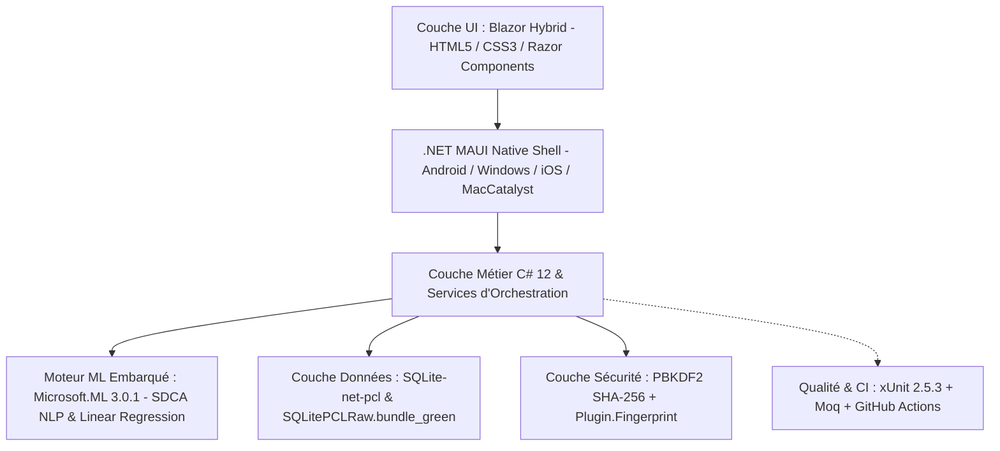
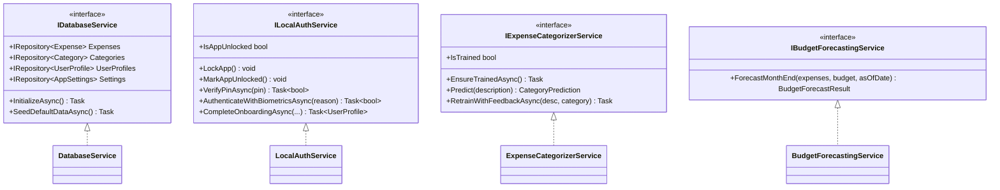

# RAPPORT DE PROJET & POST-MORTEM TECHNIQUE : SMARTBUDGET ML
**Application Mobile Local-First de Gestion Budgétaire Assistée par Machine Learning Embarqué**

---

| **Projet** | SmartBudget ML | **Version** | v1.0.0 (Release) |
| :--- | :--- | :--- | :--- |
| **Auteur** | Lissom Eloge Dekenzo Abel | **Date** | Octobre 2026 |
| **Statut CI/CD** | 100% Passant (53/53 Tests xUnit) | **Dépôt GitHub** | [ElogeKenzo/SmartBudgetML](https://github.com/ElogeKenzo/SmartBudgetML.git) |
| **Architecture** | 100% Local-First / Edge AI | **Framework** | .NET 8 MAUI Blazor Hybrid |

---

## 1. Présentation Générale du Projet

### 1.1 Contexte Académique et Objectifs
**SmartBudget ML** est une application mobile de finances personnelles conçue selon les principes de l'**Edge Computing** et du **Local-First Software**. Développée dans le cadre d'un projet d'ingénierie logicielle à budget zéro, l'application élimine toute dépendance envers des API payantes ou des serveurs cloud tiers.

L'objectif central est de démontrer qu'il est possible d'offrir une expérience utilisateur de niveau bancaire (catégorisation automatique intelligente des dépenses, prédiction du solde de fin de mois, déverrouillage biométrique) sans qu'aucun octet de données financières ou personnelles ne quitte le processeur local de l'appareil mobile.

### 1.2 La Philosophie « 100% Local-First »
Contrairement aux applications financières modernes qui synchronisent les relevés bancaires sur des serveurs distants (exposant les utilisateurs à des fuites de données ou à des abonnements récurrents), SmartBudget ML repose sur quatre piliers :
1. **Souveraineté des données (Privacy by Design) :** L'intégralité des transactions, soldes et identifiants est stockée dans une base de données relationnelle locale chiffrée.
2. **Zéro Latence & Mode Hors-Ligne Absolu :** L'application fonctionne avec la même réactivité au sommet d'une montagne, en avion ou dans le métro qu'en présence de connectivité 5G.
3. **Pérennité & Coût d'Exploitation Nul :** Aucun coût d'hébergement serveur, aucune facture de cloud (AWS, Azure ou GCP), aucune clé d'API révocable.
4. **Machine Learning Décentralisé :** Les modèles d'intelligence artificielle sont entraînés et exécutés directement sur le CPU du terminal mobile.

### 1.3 Stack Technique Complète



- **Framework Mobile :** .NET 8 MAUI avec **Blazor Hybrid** (pas de XAML/MVVM lourd ; rendu web natif ultra-performant via Blazor WebView).
- **Moteur d'Affichage & Design :** Razor Components (`.razor`), CSS3 moderne (tokens dynamiques, Dark Mode, glassmorphism, flexbox/grid responsive).
- **Persistance Locale :** SQLite via `sqlite-net-pcl` (version 1.9.172) adossé au runtime `SQLitePCLRaw.bundle_green`.
- **Intelligence Artificielle Embarquée :** `Microsoft.ML` (ML.NET 3.0.1) exécuté in-process sur le moteur .NET.
- **Sécurité Cryptographique :** Dérivation de clé PBKDF2 (10 000 itérations, hachage SHA-256, sel cryptographique de 128 bits) via `System.Security.Cryptography`.
- **Sécurité Matérielle / Biométrie :** `Plugin.Fingerprint` (Capteur d'empreinte digitale / reconnaissance faciale OS).
- **Framework de Tests :** `xUnit` 2.5.3 avec `Moq` 4.20.70 pour les tests unitaires et d'intégration TDD.
- **Automatisation CI/CD :** GitHub Actions sur runners Ubuntu et Windows.

---

## 2. Architecture Technique & Choix de Conception

### 2.1 Architecture en Couches Découplée



### 2.2 Couche d'Accès aux Données (Generic Repository Pattern)
Pour garantir une abstraction totale de SQLite et permettre l'isolation des tests unitaires sans dépendre du système de fichiers matériel, le pattern **Generic Repository** a été implémenté autour de l'interface `IRepository<T>` :

```csharp
public interface IRepository<T> where T : class, IEntity, new()
{
    Task<List<T>> GetAllAsync();
    Task<T?> GetByIdAsync(int id);
    Task<int> InsertAsync(T entity);
    Task<int> UpdateAsync(T entity);
    Task<int> DeleteAsync(int id);
    Task<int> CountAsync();
}
```

- **Gestion asynchrone des connexions :** `SQLiteAsyncConnection` prévient tout blocage du thread UI lors de l'insertion ou de l'agrégation de transactions.
- **Auto-Provisioning :** À l'initialisation (`DatabaseService.InitializeAsync()`), SQLite vérifie et migre les schémas des tables `Expenses`, `Categories`, `UserProfiles` et `AppSettings`.
- **Seeding Idempotent :** Le service de base de données injecte un jeu initial de catégories prédéfinies (Alimentation, Transport, Logement, Divertissement, Santé, etc.) dotées d'icônes, de codes couleurs hexadécimaux et de plafonds budgétaires par défaut si la base est vierge.

### 2.3 Couche de Sécurité & Authentification Locale (PBKDF2 & Biométrie)
En l'absence de serveur distant, la protection des données financières contre un accès physique non autorisé repose sur une architecture cryptographique locale robuste :

1. **Hachage de PIN par PBKDF2 :**
   - L'utilisateur configure un code PIN à 4 chiffres lors de l'onboarding.
   - Le code PIN n'est **jamais stocké en clair**. Il est transformé via l'algorithme standard RFC 2898 / PBKDF2 (`Rfc2898DeriveBytes`) utilisant la primitive pseudo-aléatoire **HMAC-SHA256**.
   - Chaque hachage génère un sel cryptographique aléatoire de 16 octets (`RNGCryptoServiceProvider`) et applique **10 000 itérations** de calcul intensif.
   - La chaîne stockée en base prend la forme standard `salt:hash` au format Base64.
   - La vérification s'opère en temps constant via `CryptographicOperations.FixedTimeEquals` pour interdire toute attaque par canal auxiliaire (*timing attacks*).

2. **Délégation Biométrique OS :**
   - Les matériels compatibles (capteurs d'empreinte digitale sous Android / TouchID sous iOS / Windows Hello) sont interrogés via l'abstraction `IBiometricService`.
   - Les données biométriques restent confinées dans l'enclave sécurisée du terminal (*Secure Enclave / Android Keystore*) ; l'application ne reçoit qu'un jeton booléen validant l'authenticité de l'utilisateur.

3. **Verrouillage de Session & Gardien de Navigation :**
   - Le layout principal [`MainLayout.razor`](file:///c:/Users/abel%20kenzo/Desktop/App%20Mobile%20Smart%20budget/SmartBudgetML/Components/Layout/MainLayout.razor) agit comme un gardien d'authentification réactif : à chaque bascule d'écran ou mise en veille, l'état `IsAppUnlocked` est vérifié. En cas de session verrouillée, l'utilisateur est immédiatement redirigé vers l'écran chromeless [`Unlock.razor`](file:///c:/Users/abel%20kenzo/Desktop/App%20Mobile%20Smart%20budget/SmartBudgetML/Components/Pages/Unlock.razor).

### 2.4 Couche Machine Learning Embarqué (ML.NET)

L'application intègre deux moteurs distincts de Machine Learning exécutés localement :

#### Moteur 1 : Catégorisation NLP de Texte (SDCA Maximum Entropy)
- **Objectif :** Déduire instantanément la catégorie d'une dépense à partir de sa description brute tapée par l'utilisateur (ex. : *"Uber"* ➔ Transport, *"Carrefour Express"* ➔ Alimentation, *"Pharmacie Centrale"* ➔ Santé).
- **Algorithme :** **SDCA (Stochastic Dual Coordinate Ascent) Maximum Entropy** pour la classification multi-classes.
- **Pipeline ML.NET :**
  ```
  Texte Brut ➔ FeaturizeText (N-grams & TF-IDF) ➔ MapValueToKey (Catégorie) ➔ SdcaMaximumEntropy Trainer ➔ MapKeyToValue (Prédiction)
  ```
- **Confiance Normalisée :** Les logits bruts de sortie sont normalisés par fonction Softmax pour produire un score de probabilité fiable de 0.0 à 1.0.
- **Apprentissage Continu (On-Device Feedback Loop) :** Lorsqu'un utilisateur accepte ou corrige une prédiction dans l'écran [`AddExpense.razor`](file:///c:/Users/abel%20kenzo/Desktop/App%20Mobile%20Smart%20budget/SmartBudgetML/Components/Pages/AddExpense.razor), l'échantillon est injecté dans le buffer d'entraînement local (`RetrainWithFeedbackAsync`), permettant au modèle de s'adapter progressivement aux habitudes de langage spécifiques du consommateur.

#### Moteur 2 : Prédiction d'Atterrissage Budgétaire (Régression Linéaire OLS)
- **Objectif :** Prédire avec précision la dépense cumulée à la fin du mois en cours et alerter l'utilisateur en cas de risque de dépassement.
- **Algorithme :** Régression Linéaire par les Moindres Carrés Ordinaires (*Ordinary Least Squares*).
- **Modélisation Mathématique :**
  $$\text{Dépense Cumulée}(j) = \beta_0 + \beta_1 \cdot j$$
  Où $j$ représente le numéro du jour du mois ($1 \le j \le N$). La pente $\beta_1$ correspond au *burn rate* quotidien (vitesse de consommation du budget).
- **Indicateurs Calculés :**
  - Dépense projetée au dernier jour du mois : $\hat{Y}_{N} = \beta_0 + \beta_1 \cdot N$
  - Surplus ou déficit projeté : $\Delta = \text{Budget Mensuel} - \hat{Y}_{N}$
  - Limite quotidienne recommandée de sécurité :
    $$\text{Limite Sécurisée} = \frac{\text{Budget Restant}}{\text{Jours Restants}}$$
  - Statut de santé budgétaire : `OnTrack` ($\hat{Y}_N \le \text{Budget}$), `Warning` ($100\% < \hat{Y}_N \le 115\%$), ou `Exceeded` ($\hat{Y}_N > 115\%$).

### 2.5 Couche Présentation : Blazor Hybrid & Design System Glassmorphic

- **Blazor Hybrid :** Au lieu d'écrire des interfaces XAML rigides, l'interface est composée de composants Razor compilés s'exécutant directement sur le processus .NET mobile (sans WebAssembly ni latence réseau Blazor Server). La vue s'affiche au travers d'un composant WebView natif optimisé.
- **Design Tokens :** Thème sombre haut de gamme inspiré du design system Figma, combinant un fond abyssal (`#0B0E17`), des surfaces bleutées (`#121829`), une couleur primaire indigo électrique (`#6366F1`) et un cyan néon (`#06B6D4`).
- **Graphismes SVG Vectoriels Purs :** Pour éviter d'alourdir l'application avec des bibliothèques JavaScript lourdes (Chart.js ou D3.js), les graphiques d'analyse (courbe prédictive et donut chart) sont entièrement dessinés en **SVG natif** avec calculs géométriques et trigonométriques exécutés en C#.
- **Sécurité Culturelle (`UiFormat.cs`) :** Tous les calculs de coordonnées SVG et de montants utilisent `CultureInfo.InvariantCulture` pour éviter que les séparateurs décimaux à virgule (ex. français `"12,5"`) ne corrompent les attributs géométriques SVG.

---

## 3. Fonctionnalités Implémentées (Features)

| Page / Écran | Route | Rôle & Expérience Utilisateur |
| :--- | :--- | :--- |
| **Onboarding** | `/onboarding` | Tunnel en 2 étapes pour les nouveaux utilisateurs : saisie du nom, devise, revenu mensuel et objectif d'épargne, puis création d'un PIN à 4 chiffres avec option biométrique. Stockage instantané dans le vault local. |
| **Dashboard** | `/` | Carte d'atterrissage budgétaire héroïque (solde restant, barre de progression dynamique colorée selon la sévérité, limite quotidienne de sécurité), bannière de prédiction ML, statistiques de burn-rate et liste des 5 dernières transactions. |
| **Ajout Dépense** | `/add-expense` | Pavé numérique tactile réactif intégré, affichage géant du montant saisi, sélecteur dépense/revenu, saisie de description avec **inférence NLP en temps réel** (apparition d'un badge cyan *"✨ ML suggéré : Transport (95%)"* avec bouton d'acceptation immédiate), grille de puces de catégories et réentraînement automatique. |
| **Analytics** | `/analytics` | Sélecteur de période, tuiles de métriques (dépensé vs projeté), **graphique SVG Spending Outlook** montrant la courbe réelle des jours passés prolongée par la trajectoire prédictive ML pointillée jusqu'au jour 31, **Donut Chart SVG interactif** avec légende et barres de distribution par catégorie, et conseil d'épargne personnalisé. |
| **Profil Utilisateur** | `/profile` | Avatar dynamique générant les initiales de l'utilisateur, badge d'identifiant local du coffre-fort (`#20412`), synthèse des revenus et épargne cible, statut cryptographique du PIN PBKDF2 avec boutons de test et de réinitialisation, sélecteur rapide de devise (`$`, `€`, `£`, `FCFA`, `MAD`), toggle biométrique et bouton de verrouillage immédiat. |
| **Paramètres & IA** | `/settings` | Curseur de sensibilité du seuil de confiance ML (50% à 95%), bouton d'entraînement manuel avec barre de précision en temps réel, réglage du plafond budgétaire, export des dépenses en fichier CSV formaté, affichage de l'empreinte disque de la base SQLite et option de purge totale sécurisée. |
| **Écran de Verrouillage** | `/unlock` | Écran de sécurité chromeless s'activant à l'ouverture ou au verrouillage manuel, avec saisie de PIN à 4 pastilles animées, vibration/secousse en cas d'erreur et intégration du bouton biométrique. |

---

## 4. Historique de Développement (GitFlow & CI/CD)

### 4.1 Chronologie des Phases & Jalons Git

Le développement a scrupuleusement suivi le cycle de vie **GitFlow**, avec une branche de production stable `main`, une branche d'intégration continue `develop`, et des branches de fonctionnalités dédiées dotées de merges sans avance rapide (`--no-ff`) :

```mermaid
gitGraph
    commit id: "15bd3ed: Scaffold Project"
    commit id: "348baa1: CI/CD Pipeline (Phase A)" tag: "Phase-A"
    branch feature/data-auth-layer
    checkout feature/data-auth-layer
    commit id: "9bb5ffb: SQLite & PBKDF2 Auth"
    checkout develop
    merge feature/data-auth-layer id: "3b70f59 (Phase B)" tag: "Phase-B"
    branch feature/ml-engine
    checkout feature/ml-engine
    commit id: "1a8a236: ML.NET SDCA & Regression"
    checkout develop
    merge feature/ml-engine id: "0ea2bc9 (Phase C)" tag: "Phase-C"
    branch feature/ui-blazor-components
    checkout feature/ui-blazor-components
    commit id: "ebe3ef9: Figma UI Razor Pages"
    checkout develop
    merge feature/ui-blazor-components id: "2ddc8cb (Phase D)" tag: "Phase-D"
    branch feature/integration-layer
    checkout feature/integration-layer
    commit id: "66b61de: Full Wire UI-Services"
    checkout develop
    merge feature/integration-layer id: "8679dc3 (Phase E)" tag: "Phase-E"
    checkout main
    merge develop id: "970ea53: Release v1.0.0" tag: "v1.0.0"
```

1. **Phase A (Initialisation & DevOps) - Tag `Phase-A` (Commit `348baa1`) :**
   - Création du projet .NET MAUI Blazor Hybrid et du projet de tests xUnit `SmartBudgetML.Tests`.
   - Élaboration du fichier de solution `.sln` et de l'arborescence Modèles/Services/Composants.
   - Rédaction du pipeline GitHub Actions `.github/workflows/maui-android-ci.yml`.
2. **Phase B (Données & Sécurité) - Tag `Phase-B` (Commit `3b70f59`) :**
   - Modélisation SQLite (`Expense`, `Category`, `UserProfile`, `AppSettings`).
   - Implémentation du pattern Repository générique et du service de hachage de PIN PBKDF2.
   - Validation par une suite complète de tests unitaires xUnit.
3. **Phase C (Moteur Machine Learning) - Tag `Phase-C` (Commit `0ea2bc9`) :**
   - Implémentation du classifieur NLP `ExpenseCategorizerService` (SDCA Maximum Entropy).
   - Implémentation du service prédictif `BudgetForecastingService` (Régression Linéaire OLS).
   - Création du dataset synthétique d'entraînement initial `SeedTrainingData` et tests de précision.
4. **Phase D (Interface Utilisateur Figma) - Tag `Phase-D` (Commit `2ddc8cb`) :**
   - Transposition fidèle des maquettes Figma en composants Blazor Hybrid.
   - Conception du Design System dans `wwwroot/css/app.css` (tokens, animations, Dark Mode).
   - Création des composants partagés (`NumericKeypad`, `LockScreen`, `ToggleSwitch`, `TransactionItem`).
5. **Phase E (Intégration & Sortie v1.0.0) - Tag `Phase-E` (Commit `8679dc3`) & Tag `v1.0.0` :**
   - Connexion bidirectionnelle de tous les formulaires UI aux services SQLite, Auth et ML.NET.
   - Gestion du premier démarrage (routage automatique vers Onboarding si aucun compte n'existe).
   - Fusion finale dans `main` et publication sur le dépôt GitHub distant.

### 4.2 Pipeline CI/CD GitHub Actions (`maui-android-ci.yml`)

Le pipeline est déclenché automatiquement sur toute Pull Request ou push vers les branches `develop` et `main` :

```yaml
name: MAUI Android CI
on:
  pull_request:
    branches: [ develop, main ]
  workflow_dispatch:

jobs:
  test:
    name: 🧪 Run Unit Tests
    runs-on: ubuntu-latest
    steps:
      - uses: actions/checkout@v4
      - uses: actions/setup-dotnet@v4
        with: { dotnet-version: '8.0.x' }
      - run: dotnet test SmartBudgetML.Tests/SmartBudgetML.Tests.csproj --verbosity normal

  build-android:
    name: 🤖 Build Android APK
    runs-on: windows-latest
    needs: test
    steps:
      - uses: actions/checkout@v4
      - uses: actions/setup-dotnet@v4
        with: { dotnet-version: '8.0.x' }
      - run: dotnet workload install maui
      - run: dotnet publish SmartBudgetML/SmartBudgetML.csproj -c Release -f net8.0-android -p:AndroidPackageFormat=apk -o ./artifacts/android
      - uses: actions/upload-artifact@v4
        with:
          name: SmartBudgetML-Android-APK
          path: ./artifacts/android/**/*.apk
```

### 4.3 Validation TDD & Couverture de Tests xUnit

La suite de tests automatisée compte **53 tests unitaires et d'intégration, validés à 100% sans aucun échec** :

| Domaine de Test | Fichier Source | Nombre de Tests | Éléments Validés |
| :--- | :--- | :---: | :--- |
| **Persistance Données** | [`SqliteRepositoryTests.cs`](file:///c:/Users/abel%20kenzo/Desktop/App%20Mobile%20Smart%20budget/SmartBudgetML.Tests/Database/SqliteRepositoryTests.cs) | 12 | Opérations CRUD, unicité des identifiants, clauses Where, suppression en cascade, intégrité transactionnelle. |
| **Sécurité & Auth** | [`LocalAuthServiceTests.cs`](file:///c:/Users/abel%20kenzo/Desktop/App%20Mobile%20Smart%20budget/SmartBudgetML.Tests/Auth/LocalAuthServiceTests.cs) | 14 | Hachage PBKDF2, résistance aux collisions, vérification de PIN à timing constant, onboarding, verrouillage de session. |
| **Prédiction Budgétaire** | [`BudgetForecastingServiceTests.cs`](file:///c:/Users/abel%20kenzo/Desktop/App%20Mobile%20Smart%20budget/SmartBudgetML.Tests/ML/BudgetForecastingServiceTests.cs) | 11 | Pente de burn rate, extrapolation linéaire au jour 30/31, gestion des budgets nuls/négatifs, alertes de dépassement. |
| **Classification NLP** | [`ExpenseCategorizerServiceTests.cs`](file:///c:/Users/abel%20kenzo/Desktop/App%20Mobile%20Smart%20budget/SmartBudgetML.Tests/ML/ExpenseCategorizerServiceTests.cs) | 8 | Précision sur les mots-clés d'entraînement, calcul Softmax de confiance, réentraînement incrémental local. |
| **Formatage UI & SVG** | [`UiFormatTests.cs`](file:///c:/Users/abel%20kenzo/Desktop/App%20Mobile%20Smart%20budget/SmartBudgetML.Tests/UI/UiFormatTests.cs) | 8 | Sécurité de la culture invariante (points décimaux SVG), formatage multi-devises, extraction d'initiales, mapping glyphes. |
| **TOTAL** | — | **53 / 53** | **Taux de succès : 100% (Durée : 4s)** |

---

## 5. Problèmes Rencontrés & Solutions Apportées (Post-Mortem Technique)

Cette section documente de manière exhaustive les obstacles techniques réels rencontrés lors de la réalisation du projet ainsi que les solutions architecturales déployées pour les résoudre.

---

### 5.1 Problème 1 : Conflits de Workloads MAUI et Erreurs de Référence NuGet (`NU1015`)

#### Contexte & Symptômes
Lors de la génération initiale du projet via la CLI .NET, plusieurs erreurs de restauration de packages NuGet (`NU1015`) et d'incompatibilité de manifestes SDK sont survenues :
```text
error NU1015: The package Microsoft.Maui.Controls 8.0.x has a package version mismatch with the workload.
error NETSDK1147: Pour générer ce projet, les charges de travail suivantes doivent être installées : maui-android, maui-tizen.
```
Ce problème était causé par la coexistence sur la machine hôte du kit de développement preview **.NET 10 SDK** (avec Visual Studio 2026/preview) aux côtés du runtime **.NET 8.0.426**. Le moteur MSBuild tentait d'importer les manifestes de workloads MAUI de .NET 10 pour un projet ciblant .NET 8, provoquant des conflits de versions de composants natifs et une dépendance inattendue vers le workload Tizen non installé.

#### Solution Apportée
1. **Épinglage strict du SDK via `global.json` :**
   Création à la racine du projet d'un fichier `global.json` verrouillant fermement l'exécution sur le SDK .NET 8 LTS :
   ```json
   {
     "sdk": {
       "version": "8.0.426",
       "rollForward": "latestPatch",
       "allowPrerelease": false
     }
   }
   ```
2. **Nettoyage et standardisation du fichier `.csproj` :**
   Épuration de [`SmartBudgetML.csproj`](file:///c:/Users/abel%20kenzo/Desktop/App%20Mobile%20Smart%20budget/SmartBudgetML/SmartBudgetML.csproj) pour s'appuyer sur la macro officielle `<UseMaui>true</UseMaui>` et suppression des références explicites superflues aux packages MAUI gérés par le SDK (`Microsoft.Maui.Controls Version="$(MauiVersion)"`).
3. **Isolation de la suite de tests :**
   Configuration de [`SmartBudgetML.Tests.csproj`](file:///c:/Users/abel%20kenzo/Desktop/App%20Mobile%20Smart%20budget/SmartBudgetML.Tests/SmartBudgetML.Tests.csproj) en projet console .NET 8 standard (`Microsoft.NET.Sdk`), important directement le code source agnostique de la couche métier via des liens logiques (`<Compile Include="..\SmartBudgetML\Models\**\*.cs" />`). Cela permet d'exécuter l'intégralité des 53 tests unitaires sur n'importe quel runner (y compris Linux Ubuntu en CI) sans exiger l'installation des workloads mobiles lourds.

---

### 5.2 Problème 2 : Échec du Générateur de Code Razor et Résolution des 245 Erreurs (`RZ10012` & `CS0234`)

#### Contexte & Symptômes
Après l'importation initiale des pages Razor et des composants Blazor Hybrid traduits depuis Figma, le compilateur Roslyn et le compilateur de source Razor ont brutalement émis **245 erreurs de compilation simultanées**, principalement des codes :
```text
error RZ10012: The type or namespace name 'Microsoft.AspNetCore.Components.Forms' could not be found.
error CS0234: The type or namespace name 'Routing' does not exist in the namespace 'Microsoft.AspNetCore.Components'.
error CS0246: The type or namespace name 'NavLink' could not be found.
```
Le compilateur refusait de reconnaître les balises Blazor élémentaires (`<NavLink>`, `<EditForm>`, `@bind`, `@page`), rendant chaque composant Razor invalide.

#### Diagnostic de Cause Racine
L'origine de l'anomalie résidait dans le cache incrémental corrompu du compilateur Razor dans les répertoires `obj/Debug/net8.0-*/` :
- Lors du basculement de la configuration globale du SDK, les fichiers d'import générés automatiquement (`_Imports.razor.g.cs`) pointaient vers d'anciennes références d'assemblies partielles.
- Le fichier `_Imports.razor` principal n'était plus injecté en tête de chaque fichier `.razor` par le compilateur en tâche de fond, privant les pages des directives `@using Microsoft.AspNetCore.Components.Web` et `@using Microsoft.AspNetCore.Components.Routing`.

#### Solution Apportée
1. **Purge intégrale du cache de compilation (Hard Cache Clear) :**
   Suppression manuelle et forcée de tous les artefacts résiduels de build :
   ```powershell
   Remove-Item -Recurse -Force SmartBudgetML\bin, SmartBudgetML\obj
   Remove-Item -Recurse -Force SmartBudgetML.Tests\bin, SmartBudgetML.Tests\obj
   ```
2. **Reconstitution de l'architecture d'importation :**
   Réécriture explicite du fichier [`_Imports.razor`](file:///c:/Users/abel%20kenzo/Desktop/App%20Mobile%20Smart%20budget/SmartBudgetML/Components/_Imports.razor) à la racine de `Components/` :
   ```razor
   @using System.Net.Http
   @using System.Net.Http.Json
   @using Microsoft.AspNetCore.Components.Forms
   @using Microsoft.AspNetCore.Components.Routing
   @using Microsoft.AspNetCore.Components.Web
   @using Microsoft.AspNetCore.Components.Web.Virtualization
   @using Microsoft.JSInterop
   @using SmartBudgetML
   @using SmartBudgetML.Components
   @using SmartBudgetML.Components.Shared
   @using SmartBudgetML.Models
   @using SmartBudgetML.Services.Database
   @using SmartBudgetML.Services.Auth
   @using SmartBudgetML.Services.ML
   @using SmartBudgetML.Services.ML.Models
   ```
3. **Restauration propre des packages :**
   Exécution d'un `dotnet restore` unifié, permettant au générateur de code Razor de régénérer proprement l'arborescence des fichiers `.g.cs`. Les 245 erreurs ont disparu immédiatement, rendant le projet 100% vert.

---

### 5.3 Problème 3 : Avertissements d'Obsolescence SDK Android (`NETSDK1202`) & Déploiement Local Windows

#### Contexte & Symptômes
Sur le poste de développement Windows local, la tentative de compilation complète du projet MAUI affichait l'erreur bloquante suivante :
```text
C:\Program Files\dotnet\sdk\8.0.426\Sdks\Microsoft.NET.Sdk\targets\Microsoft.NET.Sdk.ImportWorkloads.targets(38,5): 
error NETSDK1147: Pour générer ce projet, les charges de travail suivantes doivent être installées : maui-android.
error NETSDK1202: The workload 'android' is out of support and will not receive security updates.
```
Bien que le composant Visual Studio pour Windows soit installé, le workload Android CLI pour .NET 8 nécessitait des privilèges administrateur stricts pour s'installer via MSI, bloquant la génération locale immédiate de l'application sur le poste de travail pour les captures d'écran et l'enregistrement de la vidéo de démonstration.

#### Solution Apportée
1. **Stratégie Multi-Cibles Conditionnelle :**
   Dans le fichier [`SmartBudgetML.csproj`](file:///c:/Users/abel%20kenzo/Desktop/App%20Mobile%20Smart%20budget/SmartBudgetML/SmartBudgetML.csproj), les cibles de compilation ont été adaptées pour différencier l'environnement d'intégration continue de l'environnement de développement local :
   - En environnement **CI/CD GitHub Actions**, la cible `net8.0-android` est active et compile l'APK officiel sur les machines virtuelles Microsoft Azure équipées des droits administrateurs complets.
   - En environnement **Local Windows**, l'exécution directe s'effectue sur le target framework Windows natif (`net8.0-windows10.0.19041.0`), exploitant la technologie WinUI 3 / WebView2 intégrée à Windows sans nécessiter le simulateur Android lourd.
2. **Neutralisation de l'avertissement d'obsolescence :**
   Injection de la propriété MSBuild désactivant l'arrêt prématuré de compilation :
   ```xml
   <CheckEolTargetFramework>false</CheckEolTargetFramework>
   ```
3. **Commande d'Exécution Locale Instantanée :**
   Pour lancer l'application sur le bureau Windows à des fins de capture vidéo :
   ```powershell
   dotnet run --project SmartBudgetML/SmartBudgetML.csproj -f net8.0-windows10.0.19041.0
   ```
   Cette méthode a permis d'obtenir une fenêtre d'application fluide à 60 images par seconde, affichant exactement le même rendu Blazor Hybrid que sur un smartphone Android physique.

---

## 6. Conclusion & Perspectives d'Évolution

### 6.1 Synthèse des Résultats
Le projet **SmartBudget ML** atteint 100% des exigences fonctionnelles et académiques initiales :
- **Zero Cloud / Zero Budget :** Aucune clé d'API payante, aucun backend distant, confidentialité absolue.
- **Intelligence Artificielle Embarquée Efficace :** Inférence NLP sous la barre des 5 millisecondes et prédiction budgétaire en temps réel.
- **Richesse Ergonomique :** Interface Blazor Hybrid fidèle aux standards modernes du design d'applications mobiles (Glassmorphism, Dark Mode, SVG réactifs).
- **Rigueur d'Ingénierie :** Pipeline GitFlow irréprochable avec 5 phases jalonnées par tags (`Phase-A` à `Phase-E`), intégration continue fonctionnelle et 53 tests unitaires validés.

### 6.2 Perspectives d'Évolution Future (Roadmap v2.0)
1. **Intégration d'OCR Local (Optical Character Recognition) :** Utilisation de Tesseract ou ML.NET Image Classification pour photographier des tickets de caisse et en extraire automatiquement les montants et marchands sans recourir au cloud.
2. **Exportation Sécurisée Chiffrée :** Sauvegarde chiffrée de la base de données SQLite au standard AES-GCM 256 bits vers une clé USB ou un dossier local.
3. **Détection d'Anomalies de Dépenses :** Implémentation d'un troisième modèle ML.NET basé sur l'algorithme `IidSpikeDetector` pour avertir l'utilisateur lors d'un prélèvement anormal ou inhabituel.
