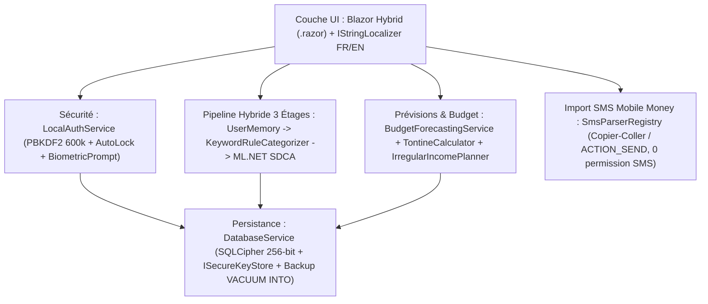

# SmartBudget ML v2.0 🇨🇲

**Application Mobile Local-First de Gestion Budgétaire, Tontines (Njangi) et Intelligence Artificielle Embarquée (.NET 10 LTS · SQLCipher 256-bit · ML.NET Hybride)**

[](#)
[](#)
[](#)
[](#)

---

## 1. Présentation Générale
**SmartBudget ML v2.0** est une application mobile Android et Windows de gestion de budget personnel conçue pour les réalités économiques du **Cameroun et d'Afrique centrale (XAF / FCFA)**, fonctionnant **100 % hors-ligne** (aucune permission `INTERNET` ni `READ_SMS`).

### Points Forts de la v2.0
- **Localisation Cameroun (FR/EN, Français par défaut) :** 17 catégories préconfigurées avec clés stables (`food_market`, `transport`, `housing_rent`, `utilities`, `telecom_data`, `healthcare`, `education`, `tontine`, `family_solidarity`, `events`, `church_donations`, `entertainment`, `savings`, `other`, `salary`, `business_hustle`, `transfers_received`) et formatage natif `25 000 FCFA`.
- **Pipeline ML.NET Hybride à 3 Étages (100 % sur appareil) :**
  1. **Étage 1 — Mémoire Utilisateur (`CategoryFeedback` SQLite) :** Priorité absolue aux corrections passées de l'utilisateur.
  2. **Étage 2 — Règles Mots-Clés Camerounais (`KeywordRuleCategorizer`) :** Plus de 150 expressions locales (*bendskin, moto, clando, ENEO, Camwater, MTN, Orange, Camtel, tontine, njangi, dîme, scolarité, marché Mokolo, Ndokoti, soya, ndolé...*).
  3. **Étage 3 — Modèle ML.NET SDCA (`SdcaMaximumEntropy`) :** Entraîné sur 314 exemples synthétiques camerounais (`seed_fr.csv`) et évalué sur un jeu de test disjoint de 176 exemples (`holdout_fr.csv`), atteignant **99,43 % de Micro-Accuracy** et **0,044 ms** de latence moyenne par prédiction.
- **Sécurité Cryptographique Réelle :**
  - Base SQLite chiffrée au repos via **SQLCipher 256 bits** (`sqlite-net-sqlcipher 1.9.172`) avec clé maître CSPRNG stockée dans l'*Android Keystore* (`ISecureKeyStore`) et migration automatique non destructive des bases v1.0 en clair.
  - Code PIN à 6 chiffres haché via **PBKDF2-HMAC-SHA256 à 600 000 itérations** (recommandation OWASP), colonnes séparées `PinSalt` et `PinHash`, rejet des PIN triviaux, anti-bruteforce persistant avec backoff exponentiel (`30s`, `1m`, `5m`, `15m`) et protection contre le recul de l'horloge système.
  - Biométrie native Android (`Android.Hardware.Biometrics.BiometricPrompt`), verrouillage automatique en arrière-plan (`AutoLockPolicy`) et masquage dans le multitâche (`FLAG_SECURE`).
- **Tontines (Njangi) & Revenus Irréguliers :**
  - Calculateur de tontines (`TontineCalculator`) : pot par tour, calendrier des tours, détection des retards, gestion des retraits et solde net ($\text{Reçu} - \text{Cotisé}$).
  - Planificateur de revenus irréguliers (`IrregularIncomePlanner`) : moyenne glissante 3–6 mois, protection du minimum vital, découpage en enveloppes hebdomadaires et suivi du ratio d'aide familiale (`family_solidarity`).

---

## 2. Architecture Technique



---

## 3. Prérequis et Commandes de Build / Test

### Prérequis
- **.NET 10.0 SDK** (`10.0.402` ou supérieur, configuré dans [`global.json`](global.json))
- Workload `.NET MAUI Android` (`dotnet workload install maui-android`) pour compiler l'APK/AAB Android.

### Exécuter la suite complète de tests (137 tests passants + 2 en attente d'échantillons SMS)
```powershell
dotnet test SmartBudgetML.Tests/SmartBudgetML.Tests.csproj -c Release
```

### Vérifier l'absence de vulnérabilités NuGet et le formatage
```powershell
dotnet list SmartBudgetML.Tests/SmartBudgetML.Tests.csproj package --vulnerable --include-transitive
dotnet format SmartBudgetML.Tests/SmartBudgetML.Tests.csproj --verify-no-changes --no-restore
```

### Générer l'APK et l'AAB Android Release
```powershell
dotnet publish SmartBudgetML/SmartBudgetML.csproj -c Release -f net10.0-android -p:AndroidPackageFormat=apk -o ./artifacts/apk
dotnet publish SmartBudgetML/SmartBudgetML.csproj -c Release -f net10.0-android -p:AndroidPackageFormat=aab -o ./artifacts/aab
```

---

## 4. Contribuer aux Parseurs SMS Mobile Money (Orange Money / MTN MoMo)
Conformément à [`docs/DECISION_SMS.md`](docs/DECISION_SMS.md), SmartBudget ML ne demande **jamais** les permissions `READ_SMS` ou `RECEIVE_SMS` et n'invente aucun format de SMS opérateur.  
Pour activer les parseurs automatiques Orange Money Cameroun et MTN MoMo Cameroun :
1. Collectez 10 à 20 vrais SMS de confirmation par opérateur (envoi, réception, retrait, dépôt, paiement marchand, crédit/data, frais).
2. Anonymisez les numéros (`6XXXXXXXX`), les noms (`NOM`) et les identifiants sensibles tout en conservant **exactement** la ponctuation, les séparateurs de montants et la structure.
3. Ajoutez les expressions régulières correspondantes dans `SmartBudgetML/Services/Sms/` et activez les tests dans [`Phase6LocalValueTests.cs`](SmartBudgetML.Tests/LocalValue/Phase6LocalValueTests.cs).

---

## 5. Documentation Complète du Projet
- [`RAPPORT_PROJET.md`](RAPPORT_PROJET.md) : Rapport d'ingénierie v2.0 et post-mortem technique complet.
- [`docs/AUDIT_REGISTER.md`](docs/AUDIT_REGISTER.md) : Registre de traçabilité des 24 constats d'audit (`A1`–`A24`).
- [`docs/ML_EVALUATION.md`](docs/ML_EVALUATION.md) : Protocole et résultats d'évaluation du pipeline ML hybride (Micro-Accuracy, Macro-F1, matrice de confusion, latence).
- [`docs/DECISION_SMS.md`](docs/DECISION_SMS.md) : Justification de l'architecture d'import SMS sans permission sensible.
- [`docs/DEVICE_TEST_CHECKLIST.md`](docs/DEVICE_TEST_CHECKLIST.md) : Protocole de test sur smartphone physique (profil Redmi 3 Go de RAM).
- [`docs/play-store/`](docs/play-store/) : Dossier complet de publication Google Play (`PUBLICATION_GUIDE.md`, `PRIVACY_POLICY_FR.md`, `PRIVACY_POLICY_EN.md`, `DATA_SAFETY.md`, `STORE_LISTING.md`).
